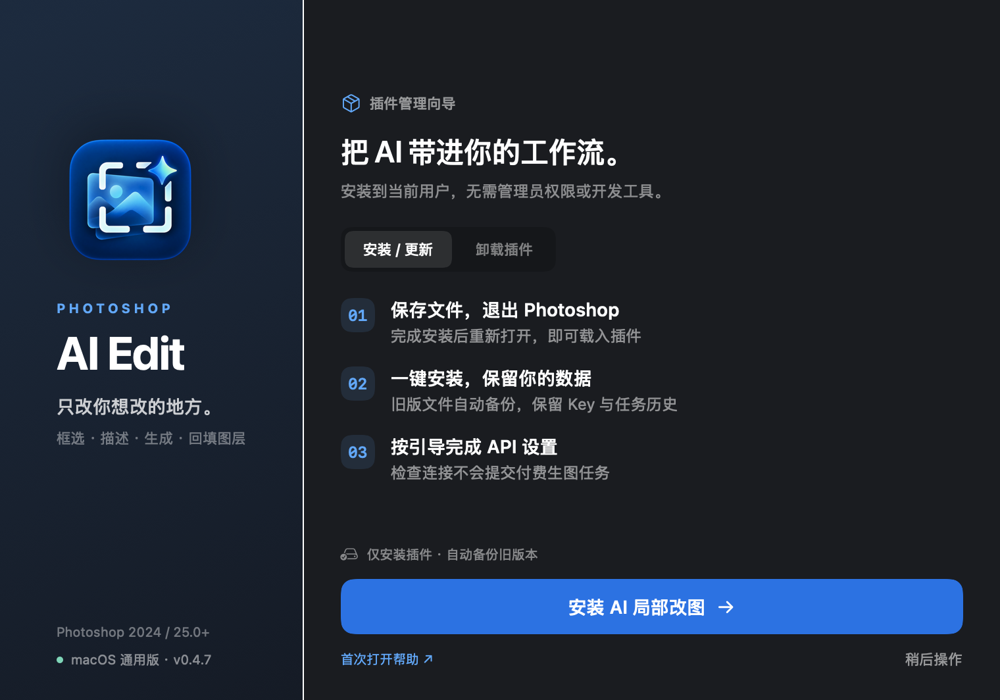

<div align="center">


# Photoshop AI Edit

### PS AI 局部改图插件 · 只改你想改的地方

框选区域，描述修改，生成结果，再回到 Photoshop 图层。

**v0.4.8** · Photoshop 2024 / 25.0+ · macOS / Windows

[下载 Mac 安装包](https://github.com/doke69/photoshop-ai-edit/releases/download/v0.4.8/Photoshop-AI-Edit-0.4.8-macOS-universal.dmg) · [下载 Windows 安装包](https://github.com/doke69/photoshop-ai-edit/releases/download/v0.4.8/Photoshop-AI-Edit-0.4.8-Windows-Setup.exe) · [下载使用说明](https://github.com/doke69/photoshop-ai-edit/releases/download/v0.4.8/Photoshop-AI-Edit-0.4.8-Guide.html)

</div>


<sub>封面为功能概念示意，非插件实际生成结果。本项目为独立插件，非 Adobe 官方产品。</sub>

在 Photoshop 中框选或套索选中区域，输入要求并按需添加参考图，通过 LK888 生成候选结果，再按原坐标添加为独立图层。适合局部换装、物品替换、颜色调整与风格参考。

[安装插件](#安装插件) · [连接-api](#连接-api) · [开始改图](#开始改图) · [常见问题](#常见问题) · [开发与许可](#开发与许可)

## 可以做什么

| 功能 | 使用体验 |
| --- | --- |
| 局部编辑，独立图层 | 读取框选／套索区域与蒙版，候选结果按原坐标回填；支持预览、下载和再次添加 |
| 参考图与标注 | 添加、粘贴或拖入图片，为风格、人物和物品提供参考；部分辅助操作需 Windows 本机助手 |
| 自动控制上传大小 | 选区先尝试 PNG 无损压缩，超过 10 MB 上传预算时等比缩小，显示处理后的尺寸与大小；外部参考图超限需自行缩小 |
| 模型同步与收藏 | 从 API 同步、搜索和收藏模型，图像能力优先，排除 Token 计费版本；按模型适配清晰度、比例及参考图限制 |
| 多选区与历史恢复 | 不同区域独立管理，保留输入、图片、参数与实际提交模型；关闭标签仍可从历史恢复 |
| 提交状态保护 | 不确定的任务先核对再重试，减少网络异常后的重复付费；批量任务查询与缩略图处理减少界面卡顿 |

## 安装插件

**下载对应系统的安装包，直接按向导安装，无需额外的插件安装工具。**

| 你的电脑 | 下载文件 | 打开方式 |
| --- | --- | --- |
| macOS · Apple Silicon / Intel | [DMG 通用安装包](https://github.com/doke69/photoshop-ai-edit/releases/download/v0.4.8/Photoshop-AI-Edit-0.4.8-macOS-universal.dmg) | 双击挂载，再打开其中的 `Install Photoshop AI Edit.app` |
| Windows | [EXE 图形安装包](https://github.com/doke69/photoshop-ai-edit/releases/download/v0.4.8/Photoshop-AI-Edit-0.4.8-Windows-Setup.exe) | 双击打开，选择「安装 / 更新」 |
| 两个平台通用 | [HTML 使用说明](https://github.com/doke69/photoshop-ai-edit/releases/download/v0.4.8/Photoshop-AI-Edit-0.4.8-Guide.html) | 下载后用浏览器打开，包含 API 创建截图与首次打开帮助 |



<sub>Mac 安装界面；Windows 安装器采用同款双栏设计。</sub>

1. 保存文件，**完全退出 Photoshop**。
2. 打开安装器，选择「安装 / 更新」，按提示完成。
3. 重新启动 Photoshop，从「增效工具」打开「AI 局部改图」。

安装到当前用户，无需管理员权限、Node.js 或 UXP 开发工具。升级自动备份旧插件文件和登记，保留本机 API Key 与任务历史。Mac 的安装器无需拖入 Applications。

<details>
<summary><strong>首次打开被系统拦截，怎么操作？</strong></summary>

当前 Mac 安装器只有临时签名，尚未取得 Apple Developer ID 签名与公证；Windows EXE 尚无代码签名。仅对从本项目 Releases 下载、确认完整且可信的文件继续操作。

- **Mac 提示无法验证开发者：**先尝试打开安装器一次，再到「系统设置 → 隐私与安全性 → 安全性」点击「仍要打开」，按提示验证身份并点击「打开」。[Apple 官方说明](https://support.apple.com/zh-cn/102445)
- **Windows 提示已保护你的电脑：**点击「更多信息」，核对文件后选择「仍要运行」。如果没有提供该选项，可能受智能应用控制或单位策略限制，请联系管理员。[Microsoft 官方说明](https://learn.microsoft.com/en-us/windows/apps/package-and-deploy/smartscreen-reputation)

如果提示恶意软件或文件已损坏，请停止并核对文件，不要关闭系统安全保护。下载的 HTML 使用说明可在运行安装器前直接查看；DMG 内也附有指南和文本说明。

</details>

## 连接 API

首次打开且未保存 Key 时，插件会进入设置页，按步骤连接你的账号。

1. 还没有账号，可通过 [LK888 注册入口](https://ac.lk888.ai/zh-CN?yonghu=UBOJB2UXX2V5ZFCU) 注册并登录；已有账号直接使用自己的 Key。
2. 在主站进入 **API 开放平台 → 控制台 → API 密钥**，创建密钥时将渠道策略选为 **「价格优先」**，额度上限按自己的预算设置。
3. 复制 Key，回到插件设置中「保存密钥」，点击「检查连接」并同步模型，然后返回改图。

API 请求地址为 `https://api.lk888.ai`。**检查连接不提交付费生图任务，实际生成使用平台额度。** Key 保存在本机 UXP 安全存储，不要放入公开截图或提交到 GitHub。

> **体验与预算参考**：新用户注册赠 1 元体验额度；GPT2.5 在「价格优先」方案下单次改图参考价低至 **¥0.025 / 张**。以上活动和价格由项目维护者提供（2026-10-18），具体条件、可用模型与实际费用以平台为准。完整创建步骤与截图见安装包附带的 HTML 使用说明。

## 开始改图


1. **读取选区**：在 RGB 文档中框选或套索选中区域，点击「读取选区」。
2. **描述修改**：填写要求，按需添加参考图，选择模型、清晰度、张数与比例。
3. **生成结果**：点击「生成当前选区」，等待任务完成。
4. **添加图层**：选择候选图，按原坐标添加为独立图层。继续编辑其他位置时点击「新建」。


<sub>基于用户提供的实机截图进行辅助排版标注；可查看[未经修改的原始截图](assets/readme/interface-original-current.png)。</sub>

## 常见问题

<details>
<summary><strong>如何卸载？会丢失 Key 和历史吗？</strong></summary>

重新打开同一安装器，切换「卸载插件」，按提示操作。先保存文件并退出 Photoshop，下次启动生效。

卸载保留 API Key、任务历史及其他插件。旧插件文件与登记备份位于 Adobe UXP 用户目录的 `Plugins/.AIEditInstallerBackups`；再次安装可继续使用原配置。面板名称为「AI 局部改图」，插件 ID 保持不变。

</details>

<details>
<summary><strong>支持哪些系统？安装测试到什么程度？</strong></summary>

需要 Photoshop 25.0（2024）及以上。Mac 安装器为 macOS 12+ 通用程序，支持 Apple Silicon / Intel；Windows EXE 需要 .NET Framework 4.8 和 Windows PowerShell 5.1。

Mac 已在隔离目录验证首次安装、升级备份、卸载、登记与私有数据保留和异常回滚，并检查原生安装界面及图标。Windows 已在 Windows Server 2022 的隔离目录验证安装、升级、卸载、回滚、最终 EXE 界面操作、1× / 2× 渲染和多尺寸图标。Windows 10 / 11 用户电脑及当前安装包在真实 Photoshop 中的加载仍待验证。

</details>

<details>
<summary><strong>语音输入、标注等辅助功能如何使用？</strong></summary>

**macOS**：在「系统设置 → 键盘 → 听写」中启用中文，聚焦修改要求后使用系统配置的听写快捷键。「听写帮助」按钮提供说明，目前没有 Mac 一键录音助手，也未接入云端语音识别 API。

**Windows**：语音、标注和部分剪贴板／拖入辅助功能需要单独启动本机助手，安装器不捆绑该服务。安装 Node.js，下载并解压 [v0.4.8 源码](https://github.com/doke69/photoshop-ai-edit/archive/refs/tags/v0.4.8.zip)，在项目目录运行：

```sh
node scripts/voice-server.cjs
```

保持终端开启，再在插件中操作。中文听写需要系统中文识别引擎和麦克风权限；助手仅监听 `127.0.0.1:17402`。Windows 助手不能直接用于 Mac。

</details>

<details>
<summary><strong>生成、回填和上传有哪些限制？</strong></summary>

- 需要 LK888 账号和额度，生成时图片与提示词会发送至平台；一次生成多张会创建多个平台任务。
- 结果需添加到原文档，画布尺寸改变会阻止自动回填。蒙版限制显示范围，但模型可能改变区域内构图。
- PNG 无损压缩与超限等比缩小是两种处理，后者可能损失细节；模型输出和回填缩放也会影响细节。
- 模型能力、账号可用渠道和参数以平台为准。任务显示「待确认」时，先到平台核对，避免重复提交。

</details>

## 开发与许可

安装包对应 [v0.4.8 标签源码](https://github.com/doke69/photoshop-ai-edit/tree/v0.4.8)；开发使用 [main 最新源码](https://github.com/doke69/photoshop-ai-edit/tree/main)。构建说明见 [installer/README.md](installer/README.md)。

<details>
<summary>本地开发与验证命令</summary>

```sh
node --test tests/*.test.cjs
python3 scripts/package.py
# 在 Mac 上构建 DMG 与其他打包产物
python3 scripts/package.py --installers
```

插件通过 140 项自动测试，接口使用模拟响应，未调用付费生图。自动测试不代表所有 Photoshop 版本与系统的实机兼容性均已验证。运行打包或预览脚本可重新生成 dist 文件。

</details>

选区捕获、坐标变换、智能对象与蒙版模块复用 [FromPS / ToPS](https://github.com/dgl-10/PhotoshopPlugin)，保留上游来源及 **CC BY-NC-SA 4.0** 许可。本项目软件代码和附带组件限非商业使用；图像使用权依输入素材与模型平台条款确定。

[许可证](LICENSE) · [来源说明](plugin/NOTICE.md) · [下载最新版](https://github.com/doke69/photoshop-ai-edit/releases/latest)
