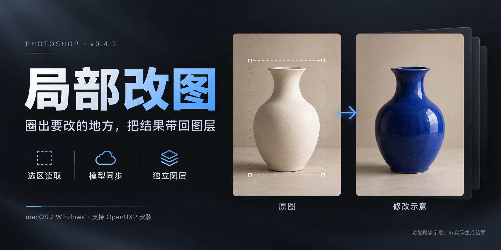
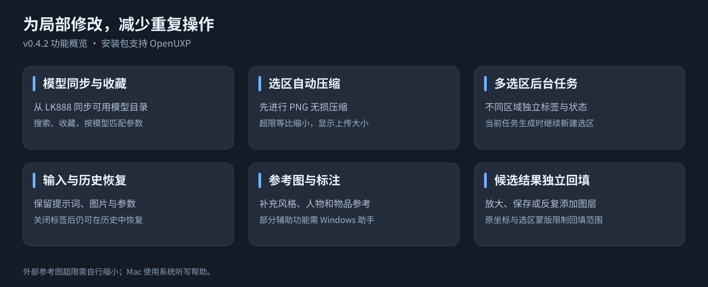
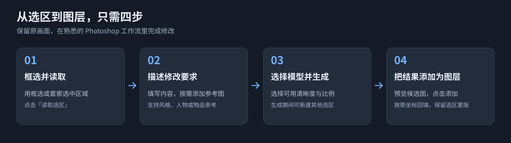

# Photoshop AI Edit — PS AI 局部改图插件



*封面为功能概念示意，非插件实际生成结果。*

**圈出要改的地方，把 AI 结果带回图层。**

在 Photoshop 中框选或套索选中区域，输入修改要求并添加参考图，通过 LK888 生成候选结果，再按原坐标添加为独立图层。适合局部换装、调整物品、风格参考等需要保留原画面其他区域的修改。

**当前发布版：v0.4.4** · Photoshop 25.0（2024）及以上 · macOS / Windows

[下载安装包](https://github.com/doke69/photoshop-ai-edit/releases/latest) · [v0.4.4 更新说明](https://github.com/doke69/photoshop-ai-edit/releases/tag/v0.4.4) · [当前版本源码](https://github.com/doke69/photoshop-ai-edit/tree/v0.4.4)

> Mac 推荐下载 DMG，Windows 下载 EXE 图形安装器；也提供 CCX 供 OpenUXP 安装。安装包附带离线 API 创建教程。源码与安装包对应 `v0.4.4` 标签。

## 主要功能



- **局部改图与蒙版回填**：读取框选／套索区域，保留原选区蒙版；候选结果按原坐标和尺寸添加为独立图层，可再次添加、放大预览和保存原图。
- **参考图与标注**：添加、粘贴或拖入参考图，为风格、人物和物品提供参考；支持图片标注，部分辅助功能需要 Windows 本机助手。
- **自动压缩选区**：先进行 PNG 无损压缩，超过单张上传预算时自动等比缩小；显示上传尺寸和大小，回填仍保留原坐标与蒙版。外部参考图超限需先自行缩小。
- **从 API 同步模型**：支持模型搜索、分页和收藏，图像能力优先排序；排除 Token 计费版本，非图像模型不能用于改图，未知能力明确提示。同步失败保留本机缓存。
- **按模型适配参数**：匹配清晰度、比例、附加选项与参考图数量限制，校验必填项和不可用规格。模型能力、账号渠道与费用以 LK888 API 为准。
- **多选区与任务历史**：独立标签管理不同区域，显示待生成、生成中、完成、失败和待确认状态；关闭标签保留历史，可恢复输入、图片与参数。
- **提交状态保护**：所选模型与提交 ID 保持一致；历史保留实际提交模型。网络异常导致结果不确定时阻止直接重复生成，部分失败保留已提交任务，剩余不自动重试。
- **语音输入**：Windows 可连接本机中文听写助手；Mac 提供系统听写帮助。当前未接入云端语音识别 API。

## 新增与优化

- 统一字体、按钮、边框、间距与卡片；选区空状态和缩略图在原位置切换，与参考图保持同排等高。
- 修改要求编辑区与工具栏重新布局，清除原生外边距与过大的内边距；支持展开编辑和面板纵向滚动。
- 模型、清晰度、张数和比例由插件统一管理状态，空格不再误开选择器。
- 首次读取选区保留已输入的修改要求和参考图；读取完成后不再被 Photoshop 通知重新展开空状态提示。
- 查询最多 3 个并发，批量保存查询结果；未变化的标签和结果不重复重建，使用小缩略图并及时释放 Photoshop 像素对象，减少重复解码与写入。

> 项目名称为 Photoshop AI Edit，面板名称为“AI 局部改图”。插件 ID 保持不变，升级可继续使用本机配置与历史。

## 安装与卸载


从 [v0.4.4 Releases](https://github.com/doke69/photoshop-ai-edit/releases/tag/v0.4.4) 下载对应平台文件：

| 安装方式 | 文件 | 操作 |
| --- | --- | --- |
| Mac DMG（Apple Silicon / Intel） | [Photoshop-AI-Edit-0.4.4-macOS-universal.dmg](https://github.com/doke69/photoshop-ai-edit/releases/download/v0.4.4/Photoshop-AI-Edit-0.4.4-macOS-universal.dmg) | 双击挂载后打开其中的安装器 |
| Mac ZIP 备用安装包 | [Photoshop-AI-Edit-0.4.4-macOS-universal.zip](https://github.com/doke69/photoshop-ai-edit/releases/download/v0.4.4/Photoshop-AI-Edit-0.4.4-macOS-universal.zip) | 完整解压，双击 `Install Photoshop AI Edit.app` |
| Windows 图形安装器（推荐） | [Photoshop-AI-Edit-0.4.4-Windows-Setup.exe](https://github.com/doke69/photoshop-ai-edit/releases/download/v0.4.4/Photoshop-AI-Edit-0.4.4-Windows-Setup.exe) | 双击打开，选择「安装 / 更新」或「卸载插件」 |
| Windows 命令行 ZIP 备用 | [Photoshop-AI-Edit-0.4.4-Windows.zip](https://github.com/doke69/photoshop-ai-edit/releases/download/v0.4.4/Photoshop-AI-Edit-0.4.4-Windows.zip) | 完整解压，双击 `Install.cmd` |
| OpenUXP / Creative Cloud | [photoshop-ai-edit-LK888-0.4.4.ccx](https://github.com/doke69/photoshop-ai-edit/releases/download/v0.4.4/photoshop-ai-edit-LK888-0.4.4.ccx) | 用对应的 UXP 安装工具打开 |

安装前保存文件并完全退出 Photoshop。安装器无需 Node.js、管理员权限或 UXP 开发工具；只更新当前用户的本插件，备份旧文件和插件登记，保留 API Key 与任务数据。备份位于 Adobe UXP 用户目录中的 `Plugins/.AIEditInstallerBackups`。安装包附带离线「安装与使用指南」，安装完成后可直接打开。Mac 安装器采用深色双栏界面与原创「选区 + 焕新」图标，提供安装 / 更新与卸载两个入口；Windows 使用同款深色双栏 EXE 安装器，内置插件和指南，无需解压，失败时可保存诊断记录；ZIP 中的 `Install.cmd` / `Uninstall.cmd` 仍可备用。卸载同样备份插件文件并保留 Key、历史和其他插件。

Windows EXE 已内嵌多尺寸品牌图标。需要手动设置快捷方式图标时，可下载 [Windows ICO](https://github.com/doke69/photoshop-ai-edit/releases/download/v0.4.4/Photoshop-AI-Edit-0.4.4-Windows.ico)。Mac Finder 可能将 EXE 显示为通用文件图标，以 Windows 显示为准。

首次打开且尚未保存 Key 时自动进入设置页：**获取 API Key → 保存 → 检查连接并同步模型 → 返回改图**。检查连接不提交付费生图；设置页显示各步完成状态，并提供注册链接。实际生成使用平台额度。

任务核对区改为独立确认行，复选标记与文字同排，长文字自然换行；恢复结果与结束记录按钮另起一行，避免原生复选框把说明挤到按钮上。

**验证范围：**安装逻辑已在 Mac 隔离目录验证首次安装、升级备份、登记保留、私有数据保留与异常保护；Windows 图形安装器在 Windows Server 2022 的隔离目录验证安装、升级、卸载、回滚和最终 EXE 界面操作；Windows 10 / 11 用户电脑与真实 Photoshop 加载仍待验证。Windows EXE 需要 .NET Framework 4.8、Windows PowerShell 5.1，尚无代码签名，可能提示发布者未知。Mac 安装器为临时签名，未取得 Apple 开发者签名 / 公证，系统可能要求手动授权或阻止打开；可使用 CCX + OpenUXP 作为备用方式。挂载磁盘使用深蓝色品牌磁盘图标；若桌面仍显示旧图标，先推出旧映像，再打开新版 DMG。

### 首次打开遇到系统提示

仅对从本项目 Releases 下载、确认完整且可信的文件继续操作。

- **Mac 提示无法验证开发者：**先尝试打开安装器一次，再到「系统设置 → 隐私与安全性 → 安全性」点击「仍要打开」，按提示确认身份并点击「打开」。[Apple 官方说明](https://support.apple.com/zh-cn/102445)
- **Windows 提示已保护你的电脑：**点击「更多信息」，核对文件后选择「仍要运行」。如果单位策略或智能应用控制没有提供此选项，请联系管理员或使用 CCX / OpenUXP。[Microsoft 官方说明](https://learn.microsoft.com/en-us/windows/apps/package-and-deploy/smartscreen-reputation)

如果系统提示恶意软件或文件已损坏，请停止并核对下载文件，不要关闭系统安全保护。新版离线指南同时包含分平台操作步骤，可在运行安装器前直接打开。

## 安装：使用 OpenUXP

1. 从 [Releases](https://github.com/doke69/photoshop-ai-edit/releases/latest) 下载 **`photoshop-ai-edit-LK888-0.4.4.ccx`**。自动生成的 Source code 压缩包是源码，不是直接安装包。
2. 安装 [OpenUXP Installer](https://moonvy.com/apps/upx-installer/)（第三方开源工具，提供 macOS / Windows 版，支持 UXP `.ccx`）。
3. 保存文件并退出 Photoshop，将 CCX 拖入 OpenUXP，核对名称“AI 局部改图”、版本和 Photoshop 宿主后安装。如官方安装方式失败，可使用工具提供的侧载方式，具体选项以所用工具版本为准。
4. 重启 Photoshop，在“增效工具”中打开“AI 局部改图”。
5. 在设置中保存自己的 LK888 API Key，检查连接并同步模型。

首次使用可先通过 [LK888 注册入口](https://ac.lk888.ai?yonghu=UBOJB2UXX2V5ZFCU) 创建账号，按平台指引获取自己的 API Key，再回到插件完成设置。已有账号可直接使用自己的 Key。

也可尝试双击 CCX 通过 Creative Cloud 安装，或使用 Adobe UXP Developer Tool 加载当前版本源码中的 `plugin/manifest.json`。此前 v0.4.2 已由用户完成 OpenUXP 实机安装验证；本次新安装器仍需实机加载确认。

## 首次使用与预算参考

安装包附带重新排版的离线使用指南，按「安装 → API 设置 → 读取与描述 → 生成与回填」介绍操作，并提供目录导航和常见问题。API 创建教程包含真实截图和位置标注：通过[注册入口](https://ac.lk888.ai/zh-CN?yonghu=UBOJB2UXX2V5ZFCU)登录后，进入「API 开放平台 → 控制台 → API 密钥」，创建时选择「价格优先」，复制 Key 后回到插件保存并检查连接。新用户注册赠 1 元体验额度（维护者提供的活动信息，具体条件与到账以平台为准）。本示例选择无限制，直接按账户余额扣费，也可按预算设置算力限额。

在 API 平台选择 **GPT2.5 · 价格优先**方案时，单次改图参考价低至 **人民币 ¥0.025 / 张**。回到插件同步并选择账号可用的对应图像模型。此价格由项目维护者提供（2026-10-18），实际费用随渠道、规格、张数和平台调价变化，以提交时平台实际计费为准。

## 实机界面与操作位置


*基于用户提供的最新实机截图，以 AI 辅助排版标注六步操作；界面细节请查看[未经修改的原始截图](assets/readme/interface-original-current.png)。*

## 使用流程



1. 在 RGB 文档中框选或套索选中要修改的区域，点击“读取选区”。
2. 按需添加参考图，填写修改要求，选择模型和参数。
3. 点击生成，完成后选择候选图添加为独立图层。
4. 修改其他区域时点击“新建”；原任务保留在标签与历史中。

## 语音与本机助手

**macOS**：在“系统设置 → 键盘 → 听写”中启用中文，聚焦修改要求后使用系统配置的听写快捷键。插件的“听写帮助”按钮提供说明，不会直接启用麦克风。目前没有 Mac 一键录音助手。

**Windows**：语音、标注和部分剪贴板／拖入辅助功能需要单独启动助手，**CCX 不包含助手**。安装 Node.js，下载并解压 [v0.4.4 源码](https://github.com/doke69/photoshop-ai-edit/archive/refs/tags/v0.4.4.zip)，在该项目目录运行：

```sh
node scripts/voice-server.cjs
```

保持终端开启，再在插件中点击语音开始／停止。中文听写需要系统中文识别引擎和麦克风权限；助手仅监听本机 `127.0.0.1:17402`。main 中已移除依赖原开发电脑路径的旧 `.cmd` 和自动加载脚本；请使用上面的通用助手启动方式。

## 使用边界

- 需要 LK888 账号和额度，图片与提示词会在生成时发送到平台；API Key 保存在本机 UXP 安全存储。一次生成多张会创建多个平台任务。
- 导入结果需回到原文档；画布尺寸改变会阻止自动回填。蒙版限制显示范围，但模型可能改变区域内构图。
- 无损 PNG 压缩与超限等比缩小是两种处理，后者可能损失细节；模型输出和回填缩放也会影响最终细节。
- Windows 与 Mac 的辅助功能不同，不能将 Windows 助手直接用于 Mac。

## 开发与验证

开发可使用 [main 最新源码](https://github.com/doke69/photoshop-ai-edit/tree/main)；已发布安装包对应 [v0.4.4 标签源码](https://github.com/doke69/photoshop-ai-edit/tree/v0.4.4)。main 已移除旧 WebView 页面、开发电脑专用脚本及生成文件的源码跟踪；运行打包或预览脚本可重新生成 dist 文件。

```sh
node --test tests/*.test.cjs
python3 scripts/package.py
# 在 Mac 上生成 DMG、ZIP 与 CCX 安装包
python3 scripts/package.py --installers
```

插件共 **132 项自动测试通过**，覆盖首次配置、同步失败引导及任务确认交互检查；接口使用模拟响应，未调用付费生图。自动测试不代表所有 Photoshop 版本、原生界面和安装工具的实机兼容性已验证。

## 来源与许可

选区捕获、坐标变换、智能对象与蒙版模块复用 [FromPS / ToPS](https://github.com/dgl-10/PhotoshopPlugin)，保留上游来源及 **CC BY-NC-SA 4.0** 许可。本项目软件代码和附带组件限非商业使用；图像使用权依输入素材与模型平台条款确定。

详见 [LICENSE](https://github.com/doke69/photoshop-ai-edit/blob/v0.4.4/LICENSE) 与 [来源说明](https://github.com/doke69/photoshop-ai-edit/blob/v0.4.4/plugin/NOTICE.md)。
