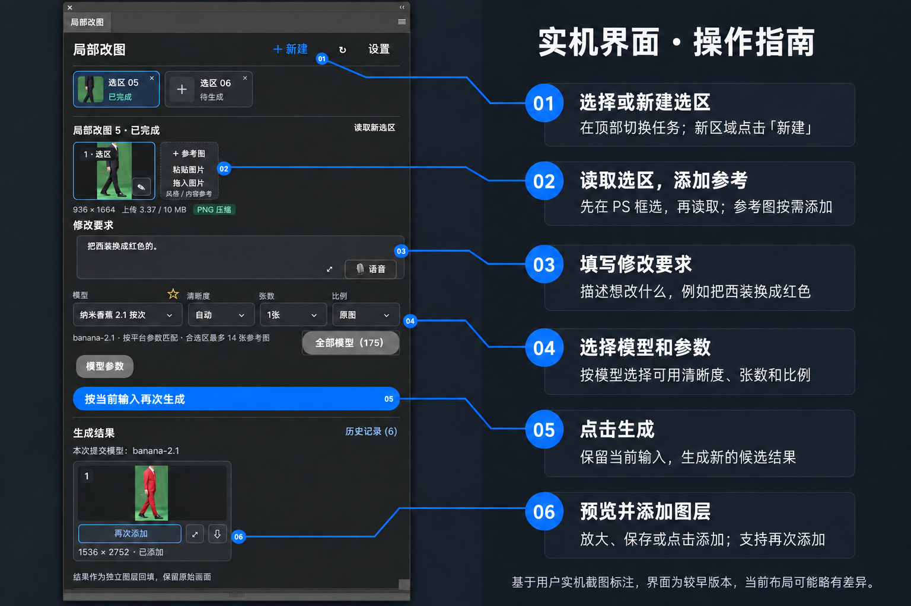

# Photoshop 局部 AI 改图插件


*封面为功能概念示意，非插件实际生成结果。*

在 Photoshop 中框选或套索选中区域，输入修改要求并添加参考图，通过 LK888 生成候选结果，再按原坐标添加为独立图层。适合局部换装、调整物品、风格参考等需要保留原画面其他区域的修改。

**当前发布版：v0.4.2** · Photoshop 25.0（2024）及以上 · macOS / Windows

[下载安装包](https://github.com/doke69/ps-local-edit/releases/latest) · [v0.4.2 更新说明](https://github.com/doke69/ps-local-edit/releases/tag/v0.4.2) · [当前版本源码](https://github.com/doke69/ps-local-edit/tree/v0.4.2)

> 安装请下载 v0.4.2 Release。`main` 已更新为最新开发源码，并完成过时文件清理；需要与发布安装包完全对应的源码时，请使用 `v0.4.2` 标签。

## 主要功能


- **局部改图与蒙版回填**：读取框选／套索区域，保留原选区蒙版；候选结果按原坐标和尺寸添加为独立图层，可再次添加、放大预览和保存原图。
- **参考图与标注**：添加、粘贴或拖入参考图，为风格、人物和物品提供参考；支持图片标注，部分辅助功能需要 Windows 本机助手。
- **自动压缩选区**：先进行 PNG 无损压缩，超过单张上传预算时自动等比缩小；显示上传尺寸和大小，回填仍保留原坐标与蒙版。外部参考图超限需先自行缩小。
- **从 API 同步模型**：支持模型搜索、分页和收藏，图像能力优先排序；排除 Token 计费版本，非图像模型不能用于改图，未知能力明确提示。同步失败保留本机缓存。
- **按模型适配参数**：匹配清晰度、比例、附加选项与参考图数量限制，校验必填项和不可用规格。模型能力、账号渠道与费用以 LK888 API 为准。
- **多选区与任务历史**：独立标签管理不同区域，显示待生成、生成中、完成、失败和待确认状态；关闭标签保留历史，可恢复输入、图片与参数。
- **提交状态保护**：所选模型与提交 ID 保持一致；历史保留实际提交模型。网络异常导致结果不确定时阻止直接重复生成，部分失败保留已提交任务，剩余不自动重试。
- **语音输入**：Windows 可连接本机中文听写助手；Mac 提供系统听写帮助。当前未接入云端语音识别 API。

## 新增与优化

- 统一字体、按钮、边框、间距与卡片；选区空状态和缩略图在原位置切换，与参考图保持同排等高。
- 修改要求编辑区与工具栏重新布局，清除原生外边距与过大的内边距；支持展开编辑和面板纵向滚动。
- 模型、清晰度、张数和比例由插件统一管理状态，空格不再误开选择器。
- 首次读取选区保留已输入的修改要求和参考图；读取完成后不再被 Photoshop 通知重新展开空状态提示。
- 查询最多 3 个并发，批量保存查询结果；未变化的标签和结果不重复重建，使用小缩略图并及时释放 Photoshop 像素对象，减少重复解码与写入。

## 安装：使用 OpenUXP

1. 从 [Releases](https://github.com/doke69/ps-local-edit/releases/latest) 下载 **`ps-local-edit-LK888-0.4.2.ccx`**。自动生成的 Source code 压缩包是源码，不是直接安装包。
2. 安装 [OpenUXP Installer](https://moonvy.com/apps/upx-installer/)（第三方开源工具，提供 macOS / Windows 版，支持 UXP `.ccx`）。
3. 保存文件并退出 Photoshop，将 CCX 拖入 OpenUXP，核对名称“局部改图”、版本和 Photoshop 宿主后安装。如官方安装方式失败，可使用工具提供的侧载方式，具体选项以所用工具版本为准。
4. 重启 Photoshop，在“增效工具”中打开“局部改图”。
5. 在设置中保存自己的 LK888 API Key，检查连接并同步模型。

也可尝试双击 CCX 通过 Creative Cloud 安装，或使用 Adobe UXP Developer Tool 加载当前版本源码中的 `plugin/manifest.json`。本包已由用户完成 OpenUXP 实机安装验证。

## 实机界面与操作位置



*基于你提供的较早版本实机截图，以 AI 辅助排版标注操作位置；细节请查看[未经修改的原始截图](assets/readme/interface-original.png)，当前布局可能略有差异。*

## 使用流程


1. 在 RGB 文档中框选或套索选中要修改的区域，点击“读取选区”。
2. 按需添加参考图，填写修改要求，选择模型和参数。
3. 点击生成，完成后选择候选图添加为独立图层。
4. 修改其他区域时点击“新建”；原任务保留在标签与历史中。

## 语音与本机助手

**macOS**：在“系统设置 → 键盘 → 听写”中启用中文，聚焦修改要求后使用系统配置的听写快捷键。插件的“听写帮助”按钮提供说明，不会直接启用麦克风。目前没有 Mac 一键录音助手。

**Windows**：语音、标注和部分剪贴板／拖入辅助功能需要单独启动助手，**CCX 不包含助手**。安装 Node.js，下载并解压 [v0.4.2 源码](https://github.com/doke69/ps-local-edit/archive/refs/tags/v0.4.2.zip)，在该项目目录运行：

```sh
node scripts/voice-server.cjs
```

保持终端开启，再在插件中点击语音开始／停止。中文听写需要系统中文识别引擎和麦克风权限；助手仅监听本机 `127.0.0.1:17402`。main 中已移除依赖原开发电脑路径的旧 `.cmd` 和自动加载脚本；请使用上面的通用助手启动方式。

## 使用边界

- 需要 LK888 账号和额度，图片与提示词会在生成时发送到平台；API Key 保存在本机 UXP 安全存储。一次生成多张会创建多个平台任务。
- 导入结果需回到原文档；画布尺寸改变会阻止自动回填。蒙版限制显示范围，但模型可能改变区域内构图。
- 无损 PNG 压缩与超限等比缩小是两种处理，后者可能损失细节；模型输出和回填缩放也会影响最终细节。
- Windows 与 Mac 的辅助功能不同，不能将 Windows 助手直接用于 Mac。

## 开发与验证

开发可使用 [main 最新源码](https://github.com/doke69/ps-local-edit/tree/main)；已发布安装包对应 [v0.4.2 标签源码](https://github.com/doke69/ps-local-edit/tree/v0.4.2)。main 已移除旧 WebView 页面、开发电脑专用脚本及生成文件的源码跟踪；运行打包或预览脚本可重新生成 dist 文件。

```sh
node --test tests/*.test.cjs
python3 scripts/package.py
```

v0.4.2 共 **129 项自动测试通过**，接口使用模拟响应，未调用付费生图。自动测试不代表所有 Photoshop 版本、原生界面和安装工具的实机兼容性已验证。

## 来源与许可

选区捕获、坐标变换、智能对象与蒙版模块复用 [FromPS / ToPS](https://github.com/dgl-10/PhotoshopPlugin)，保留上游来源及 **CC BY-NC-SA 4.0** 许可。本项目软件代码和附带组件限非商业使用；图像使用权依输入素材与模型平台条款确定。

详见 [LICENSE](https://github.com/doke69/ps-local-edit/blob/v0.4.2/LICENSE) 与 [来源说明](https://github.com/doke69/ps-local-edit/blob/v0.4.2/plugin/NOTICE.md)。
